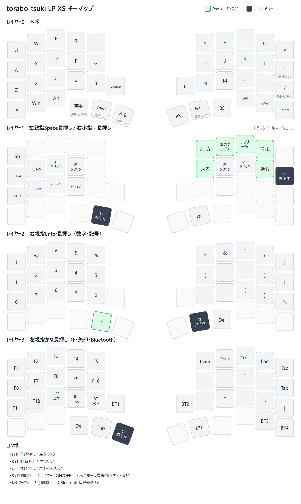

[torabo-tsuki LP](https://github.com/sekigon-gonnoc/torabo-tsuki-lp)用のZMKファームウェア

* _centralがついているuf2をトラックボールがついている方に、_peripheralを反対側に書き込んでください
* キーマップはkeymap-editorおよびzmk-studioで編集できます
## キーマップ

画像は `tools/gen_keymap_svg.py` で生成しています（`python tools/gen_keymap_svg.py img/keymap.svg` → ブラウザでPNG化）。キーマップを変えたらスクリプト内の表も更新してください。
